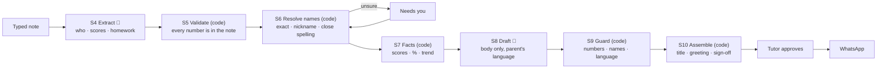

# TuitionSetu

**Turn a private tutor's class notes into WhatsApp updates for parents — written by an open-weight model on the tutor's own laptop, and checked by code before anything is sent.**

Mita teaches Maths to 30 children from home. After each batch she jots shorthand like `Riya ch5 test 14/20 careless in algebra, missed HW twice; Arjun absent`. On Sunday evening she spends two hours turning a week of those notes into a message for every parent, in English, Bengali or Hindi.

TuitionSetu does the Sunday part:

1. **She types the note as she always does**, on her phone or laptop, right after class.
2. **The laptop reads it** with a local model: who each line is about, scores, homework, attendance. Anything it isn't sure of (a name it doesn't know, a score without a total) waits in **Needs you**; it never guesses.
3. **On report day it writes each parent's update** in the parent's language and checks it against her notes: every number must come from them, no other child may be named, and the language must be right. A number the model made up is highlighted, and the update can't be approved until it's fixed.
4. **She reads, approves and taps Send on WhatsApp.** WhatsApp opens with the message ready; she presses Send herself.

Children's details never leave the laptop. There is no cloud account, no API key and no per-message cost.

## Quick start (macOS or Linux)

You need **[Node.js](https://nodejs.org/en/download) 22 or newer** and **[Ollama](https://ollama.com/download)**. Then:

```bash
git clone https://github.com/souptik4572/tuition-setu.git && cd tuition-setu && ./setup.sh
./start.sh
```

Open **http://localhost:3000** and the setup wizard walks you through your name, a PIN, a check of the AI engine and your students.

`./setup.sh` checks Node and Ollama, installs packages, creates `.env.local`, downloads the AI model (about 6.6 GB, once), creates the database and builds the app. It asks whether to add six fictional sample students to try things out. It's safe to run again, and running it after `git pull` applies the update. Flags: `--yes` (no questions), `--skip-models`, `--lan`.

### Use it from your phone

```bash
./start.sh --lan
```

It prints an address such as `http://192.168.1.20:3000`. Open it on a phone on the same Wi-Fi and sign in with your PIN. The phone talks only to the laptop; the laptop talks only to Ollama on itself.

### Choose the AI models

Models are set in `.env.local`. Edit it and restart TuitionSetu; no rebuild is needed. Pull a model first with `ollama pull <name>`.

```bash
MODEL_EXTRACT=qwen3.5:9b                 # reads your notes (default gemma4:latest)
MODEL_DRAFT=gemma4:latest                # writes the parent updates (default gemma4:latest)
MODEL_QUALITY_DRAFT=gemma4:12b           # the larger writing model offered by quality mode
MODEL_ALTERNATES=qwen3.5:9b,gemma4:e4b   # "Try the other model" for a note that couldn't be read
```

If a named model isn't installed, the setup wizard and the note show the exact `ollama pull` command, and the note is read as soon as the model is there.

## How it works



**The model writes; code checks.** Two model calls do the language work: reading shorthand and writing a warm paragraph in Bengali. Everything a parent could act on is code: the numbers, the names, the percentages and the trend are worked out from the notes, and the guard compares every number in the draft with them, including Bengali and Devanagari digits. The greeting, fee reminder and sign-off come from templates, never from the model.

```
 Phone (browser, same Wi-Fi)          Laptop
 ┌─────────────────────────┐   LAN   ┌──────────────────────────────────────┐
 │ Type a note             │ ──────▶ │ Next.js server                       │
 │ Review · Send on WhatsApp│        │  ├─ pipeline (lib/pipeline)          │
 └───────────┬─────────────┘        │  ├─ SQLite  data/tuition-setu.db     │
             │ wa.me link            │  └─ Ollama at 127.0.0.1:11434        │
             ▼                       │      (open-weight models)            │
        WhatsApp app                 └──────────────────────────────────────┘
```

- **Privacy:** the server listens on `127.0.0.1` unless you start it with `--lan`; every page needs the PIN; the app makes no internet requests at runtime (fonts are bundled at build time); AI runs log timings and token counts, never note or message text. If the AI engine is ever pointed at another machine, the home screen shows a red warning.
- **If the AI engine is off,** notes still save instantly and are read automatically once it's back.
- **Stack:** Next.js 16, React 19, TypeScript, Tailwind CSS, Drizzle ORM with SQLite, Zod, Ollama.

## Everyday commands

| Command | Does |
|---|---|
| `./start.sh` / `./start.sh --lan` | Start TuitionSetu (and Ollama, if it isn't running) |
| `npm run reset-pin` | Choose a new PIN or passphrase on the laptop; every device is signed out |
| `npm test` | Run the tests |
| `npm run eval -- --model <name>` | Score how well a model reads the sample notes in `evals/fixtures` ([results](./evals/results/summary.md)) |
| `npm run dev` | Development server |

## Status

Built for DEV's Hacktoberfest 2026 Open-Source AI Challenge (Week 2, "Side Hustle"). This is the local version's MVP: setup, students, typed notes, Needs you, drafting with the guard, the weekly review and WhatsApp sending. Not built yet: photos of the register, a settings page, the hosted version and Windows scripts. The Bengali and Hindi message templates still need a native speaker's review.

[SPEC.md](./SPEC.md) describes the full product: the pipeline rules, prompts, data model and the hosted design.

## License

[Apache 2.0](./LICENSE)
